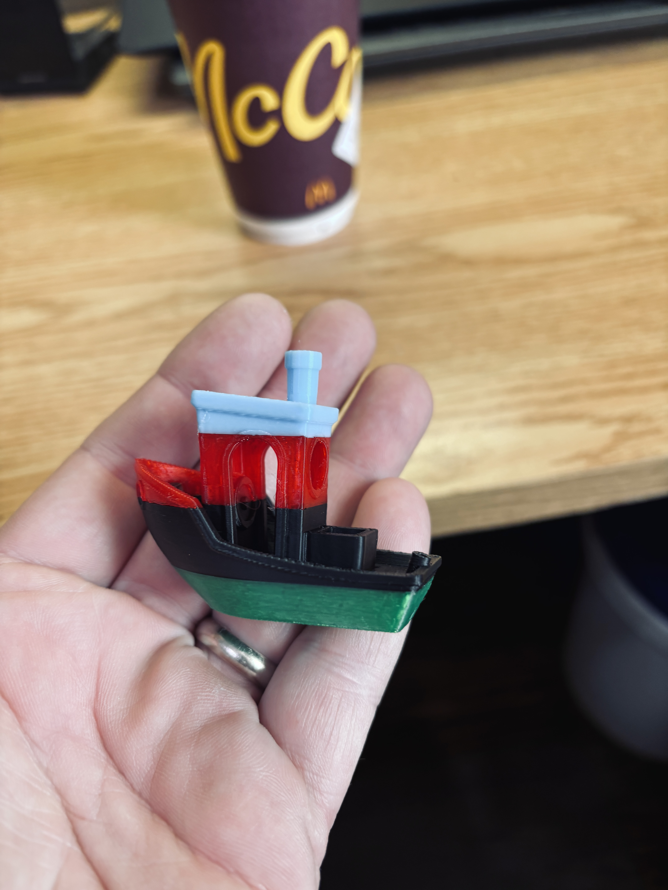
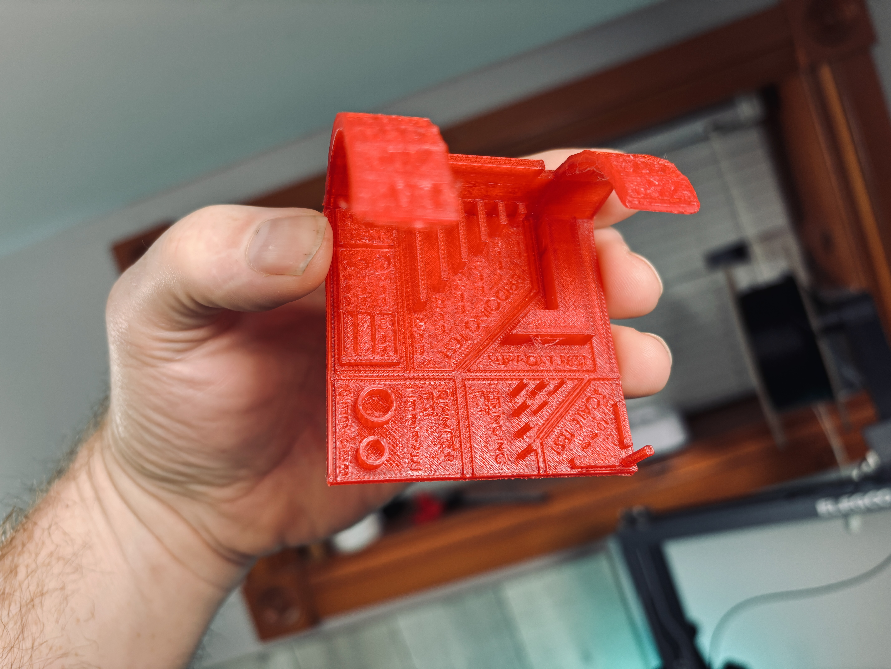
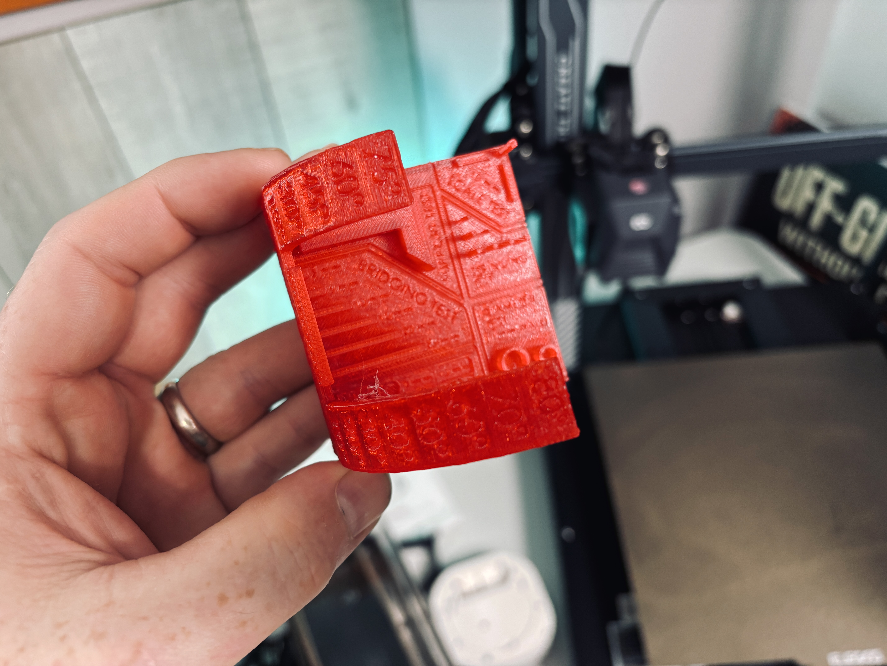

# WonderMaker ZR Ultra S

My WonderMaker ZR Ultra S print results, slicer presets, and useful links. I'll keep the settings and things I figure out here so they're easy to find alongside my videos.

  <a href="https://www.youtube.com/mkmeorg">YouTube</a> |
  <a href="https://twitter.com/mkmeorg">Twitter</a> |
  <a href="https://www.mkme.org">mkme.org</a> |
  <a href="https://discord.gg/j9S4Fgv">MKme Discord</a> 
  <a href="https://ko-fi.com/mkmeorg">Buy me a coffee</a> |
  <a href="https://www.patreon.com/EricWilliam">Support on Patreon</a>

## PLA print results

Some of my PLA prints from the WonderMaker: a multicolor Benchy and a red calibration test shown from two angles. Click a photo for the full-resolution image.

### Multicolor Benchy

### Calibration test

The two views show the lettering, holes, thin features, and overhangs, including the visible surface texture and a little stringing.

## My slicer presets

- [Filament presets](Filament%20presets.zip) — my WonderMaker PLA Basic preset.
- [Process presets](Process%20presets.zip) — my preset based on `0.20mm Standard @WonderMaker ZR Ultra`.

The saved PLA preset uses these overrides:

| Setting | Value |
| --- | --- |
| Nozzle temperature | 215°C first layer; 210°C after |
| Flow ratio | 0.92 |
| Pressure advance | Enabled; 0.024 |
| Minimum fan speed | 80% |
| Minimum print speed when slowing for cooling | 10 mm/s |

These are starting points for tuning your own filament. The exports inherit built-in WonderMaker profiles, so use a slicer with the matching base profiles and check the printer, nozzle, and material selections before printing.

## PETG settingsadjusted

A rough list of the settings adjusted for PETG.

### Filament settings — WonderMaker PETG Basic - erger

- Filament flow ratio
- Enable pressure advance
- Pressure advance
- Nozzle temperature
- Initial-layer nozzle temperature
- Retract when changing layer
- Overhangs/external bridges fan speed
- Keep fan always on
- Initial-layer bed temperature

### Process settings

- Enable accel_to_decel
- Normal/default acceleration
- Outer-wall acceleration
- Inner-wall acceleration
- Travel acceleration
- Gap-infill speed
- Top-surface speed
- Bridge flow ratio
- Internal bridge flow ratio
- Bridge speed
- Internal bridge speed
- Thick internal bridges
- Slow down for curled perimeters
- Precise Wall
- Sparse-infill density
- Brim type

## Official WonderMaker links

| Resource | Link |
| --- | --- |
| Manufacturer website and printer information | [WonderMaker 3D](https://wondermaker3d.com/) |
| Official Facebook group | [WonderMaker 3D group](https://www.facebook.com/groups/wondermaker3d) |
| Official Discord | [WonderMaker 3D Discord](https://discord.gg/wondermaker3d) |
| Slicer downloads | [Wonderprint-Orca](https://wondermaker3d.com/software/pc/) |
| Manuals | [WonderMaker manual downloads](https://wiki.wondermaker3d.com/en/Manual-Download) |

The official community links above are listed on [WonderMaker's website](https://wondermaker3d.com/). This is my personal printer resource repo, not an official WonderMaker support page.

## Filament, tools, and supporting the channel

Amazon affiliate links below help support my projects. As an Amazon Associate I earn from qualifying purchases.

These are Amazon Canada searches for supplies, not claims about the exact filament brands used in the photos. Check the size and compatibility before ordering.

| Supplies | Amazon affiliate link |
| --- | --- |
| PLA filament | [Shop PLA filament](https://www.amazon.ca/s?k=PLA+filament+1.75mm&tag=wbca-20) |
| Filament storage bags and desiccant | [Shop filament storage](https://www.amazon.ca/s?k=3d+printer+filament+storage+bags+desiccant&tag=wbca-20) |
| Digital calipers for checking prints | [Shop digital calipers](https://www.amazon.ca/s?k=digital+caliper&tag=wbca-20) |
| Deburring and print cleanup tools | [Shop print cleanup tools](https://www.amazon.ca/s?k=3d+print+deburring+tool&tag=wbca-20) |

## More of my 3D printing projects

- [3D printing videos](https://www.youtube.com/playlist?list=PLxyM2a_cfnzh4BQ6e20lYyFzN7XcakLek)
- [Elegoo Neptune 4 MAX](https://github.com/MKme/Neptune4MAX)
- [Anycubic I3 Mega settings and resources](https://github.com/MKme/I3-Mega-3D-Printer-Settings-Resources)
- [Creality CR10 settings and reference](https://github.com/MKme/CR10-3D-Printer-Settings-and-Reference)
- [Resin printing resources](https://github.com/MKme/resinprinting)
